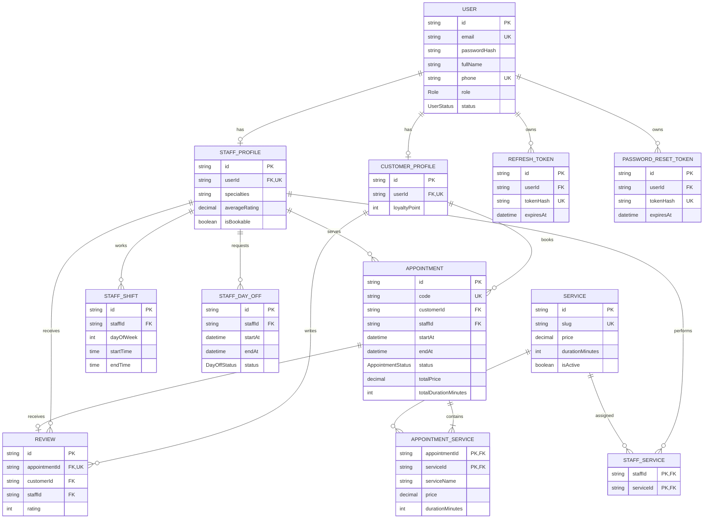

# ERD – Hệ thống đặt lịch Royal Barber

`AppointmentService` lưu snapshot tên, giá và thời lượng tại thời điểm đặt để lịch cũ không bị thay đổi khi bảng giá được cập nhật. Ràng buộc đánh giá một lần được bảo đảm bằng unique key trên `appointmentId`; điều kiện lịch đã `COMPLETED` sẽ được kiểm tra trong transaction ở tầng service (Giai đoạn 3).
